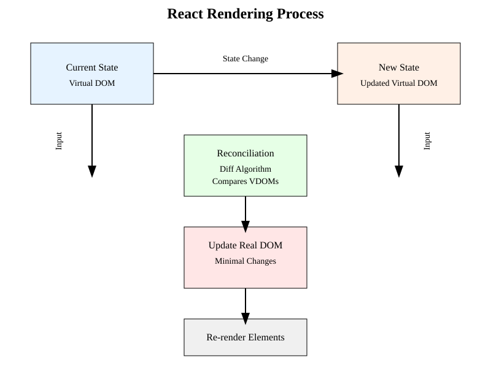
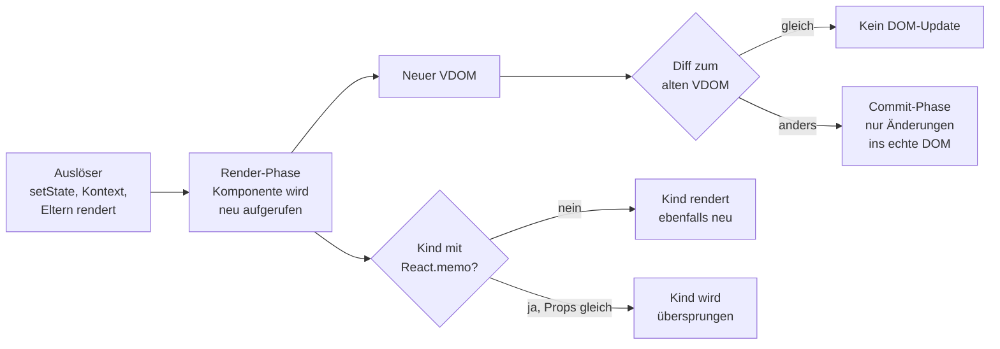
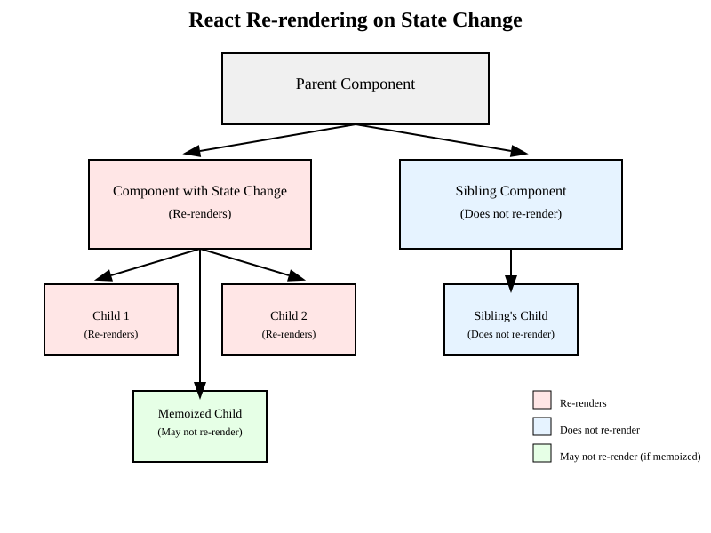
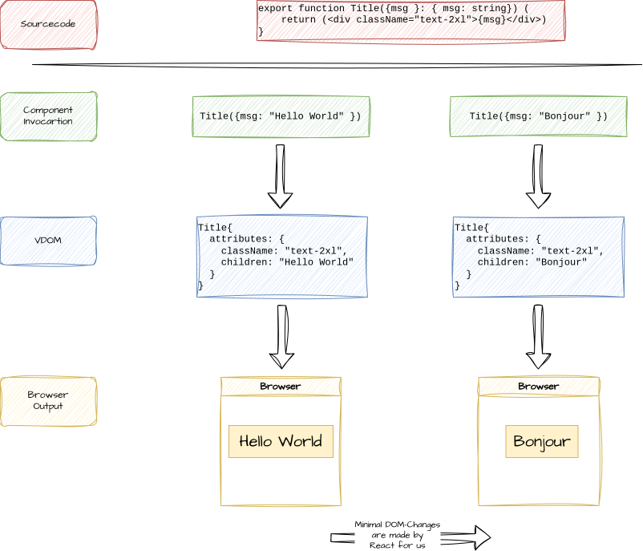
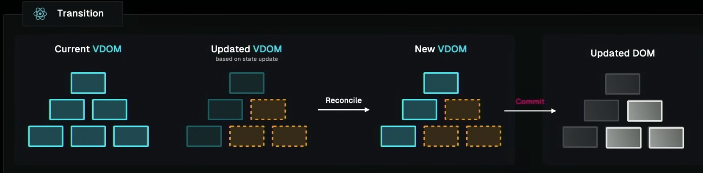

# 3.1 Komponenten, Props und State / Funktionskomponenten erstellen

## Konzepte

- Modernes React verwendet Funktionale Komponenten und Hooks
- Funktionale Komponenten sind einfacher zu lesen und zu schreiben
- Funktionale Komponenten sind JavaScript-Funktionen mit folgenden Eigenschaften:  
\

1. Sie akzeptieren optional ein Objekt mit Eigenschaften (props) und geben React-Elemente (=JSX) zurück
2. Die Bezeichnung der Funktion muss mit einem Großbuchstaben beginnen
3. Innerhalb von Komponenten können Hooks verwendet werden


# 3.1 Komponenten, Props und State / Funktionskomponenten erstellen

## Komponenten-State und Komponenten-Ereignisse

- Komponenten haben einen State (Zustand) und Ereignisse (State und Events)
- Status wird mittels des eingebauten Hooks `useState` verwaltet. 
- Der Aufruf von `useState` gibt ein Array zurück, das den aktuellen Status und eine Funktion zum Setzen des Status enthält.
- Der Status ist immer an die aktuelle Komponente gebunden.
- Aufgerufene Funktionen die useState verwenden, gehören auch zur aktuellen Komponente. Der Status gehört also nicht zu der aufgerufenen Funktion, sondern zur aktuellen Komponente.
- Solche Funktionen heißen gemeinhin "Hook-Funktionen" und werden mit dem Präfix `use` benannt.

# 3.1 Komponenten, Props und State / Funktionskomponenten erstellen

## Rerendering




# 3.1 Komponenten, Props und State / Funktionskomponenten erstellen

## Rerendering (2)

Der Rerendering-Prozess in React ist ein zentraler Bestandteil des Frameworks. Er beschreibt, wie React die Benutzeroberfläche aktualisiert, wenn sich der Zustand einer Komponente oder ein abonnierter Kontext ändert.

Die Grundüberlegung ist, dass React den virtuellen DOM (Document Object Model) verwendet, um Änderungen effizient zu verfolgen und nur die Teile der Benutzeroberfläche zu aktualisieren, die sich tatsächlich geändert haben.

- Wenn sich der Zustand einer Komponente oder ein abonnierter Kontext ändert, wird die Komponente neu gerendert. Eltern-Komponenten rendern außerdem ihre Kinder mit (außer bei `React.memo`).
- React vergleicht den neuen virtuellen DOM mit dem vorherigen virtuellen DOM.
- Nur die Teile des echten DOM, die sich geändert haben, werden aktualisiert.
- Die Änderungen an der GUI (sprich dem DOM) werden durch ein Rerendering ausgelöst. Das Rerendering erzeugt einen neuen VDOM und vergleicht diesen mit dem alten VDOM.
- React verwendet den Diffing-Algorithmus, um die Unterschiede zwischen dem alten und dem neuen VDOM zu ermitteln.
- Nur die Teile des echten DOM, die sich geändert haben, werden aktualisiert. Damit ist die GUI des Browser sehr stabil und performant.

# 3.1 Komponenten, Props und State / Funktionskomponenten erstellen

## Rerendering (3)

- Für die React-Entwicklung bedeutet dies:

- Komponenten werden nur in Gänze neu gerendert. Wenn eine Eltern-Komponente neu gerendert wird, werden auch alle Kinder-Komponenten neu gerendert (außer bei `React.memo`).

- Re-Renders werden ausgelöst durch: State-Änderungen, Kontext-Änderungen oder das Re-Rendering der Eltern-Komponente. Props sind das Ergebnis eines Re-Renderings — nicht dessen Ursache.


# 3.1 Komponenten, Props und State / Funktionskomponenten erstellen

## Rerendering: Ablauf



# 3.1 Komponenten, Props und State / Funktionskomponenten erstellen

## Rerendering: Was wird neu gerendert?



# 3.1 Komponenten, Props und State / Funktionskomponenten erstellen

## Rerendering (4)




# 3.1 Komponenten, Props und State / Funktionskomponenten erstellen

## Render-Phase und Commit-Phase

React unterteilt jeden Rendering-Zyklus in zwei klar getrennte Phasen:

**Render-Phase** (pure, keine Seiteneffekte):
- React ruft die Komponenten-Funktion auf und erzeugt einen neuen virtuellen DOM-Baum
- React vergleicht (diffed) den neuen VDOM mit dem vorherigen VDOM (Reconciliation)
- Diese Phase kann von React unterbrochen, pausiert oder wiederholt werden (z.B. in Concurrent Mode)
- Keine DOM-Änderungen — nur Berechnung der Unterschiede

**Commit-Phase** (mit Seiteneffekten):
- React überträgt die berechneten Änderungen in den echten DOM
- `useEffect`- und `useLayoutEffect`-Callbacks werden ausgeführt
- Ref-Objekte (`useRef`) werden auf die echten DOM-Knoten gesetzt
- Diese Phase läuft synchron und kann nicht unterbrochen werden


# 3.1 Komponenten, Props und State / Funktionskomponenten erstellen

## Render-Phase und Commit-Phase (Diagramm)



# 3.1 Komponenten, Props und State / Funktionskomponenten erstellen

## Auslöser für Re-Renders im Detail

Es gibt genau drei direkte Auslöser für ein Re-Rendering einer Komponente:

1. **State-Änderung** — Aufruf der Setter-Funktion von `useState` oder `useReducer` innerhalb der Komponente
2. **Kontext-Änderung** — der Wert eines abonnierten Context-Providers hat sich geändert (`useContext`)
3. **Eltern-Komponente rendert neu** — alle Kind-Komponenten werden automatisch mitgerendert (außer bei `React.memo`)

**Wichtig: Props sind keine direkte Ursache für Re-Renders!**
- Props sind das *Ergebnis* eines Renders der Eltern-Komponente, nicht der Auslöser
- Eine Kind-Komponente rendert neu, weil die Eltern-Komponente neu rendert — nicht weil sich Props geändert haben
- `React.memo` optimiert genau das: Es verhindert das Re-Render des Kindes, wenn sich die Props nicht geändert haben


# 3.1 Komponenten, Props und State / Funktionskomponenten erstellen

## Context als Dependency Injection

React Context kann als eingebautes **Dependency-Injection-System** (DI) betrachtet werden:

- **Provider** injiziert einen Wert in den Komponentenbaum — vergleichbar mit einem DI-Container
- **Consumer** (`useContext`) empfängt den injizierten Wert — ohne explizite Prop-Weitergabe (Prop Drilling)
- Jede Komponente im Baum unterhalb des Providers kann den Wert direkt abonnieren

```typescript
// 1. Context erstellen (das "Interface")
const ThemeContext = createContext<"light" | "dark">("light")

// 2. Provider — injiziert den Wert (der "Container")
export function App() {
    return (
        <ThemeContext.Provider value="dark">
            <MainLayout />
        </ThemeContext.Provider>
    )
}

// 3. Consumer — empfängt den Wert (der "Injektionspunkt")
function Button() {
    const theme = useContext(ThemeContext)
    return <button className={theme}>Click</button>
}
```

Typische Anwendungsfälle: Theme, Authentifizierung, Sprache/i18n, globale App-Konfiguration.

**Achtung:** Jede Komponente, die `useContext` verwendet, rendert neu, sobald sich der Context-Wert ändert — auch wenn sie den geänderten Teil des Wertes gar nicht nutzt.


# 3.1 Komponenten, Props und State / Funktionskomponenten erstellen

## Ein Beispiel

- In React erstellt man Komponenten um diese in anderen Komponenten wiederzuverwenden.

- Beispiel: 
- Komponente für Links:  <LinkRenderer>
- Komponente für Benutzer-Bilder: <UserPicture>
- Komponente für verlinkte Benutzer-Bilder:

```typescript
export function UserPictureWithLink(props) {
        return <div><UserPicture user={props.user}/><LinkRenderer link=”...”/></div>
}
```

# 3.1 Komponenten, Props und State / Funktionskomponenten erstellen

## Zentrale Philosophie und Erfolgsrezept für Reactprojekte

- Erstellen von Komponenten, die nur eine Aufgabe erfüllen
- Komponenten sind möglichst klein
- Einfache Komponenten haben keinen Zustand, sondern nur Props oder Children

- Custom Hooks um Logik zentral zu verwalten und reaktiv wiederzuverwenden

