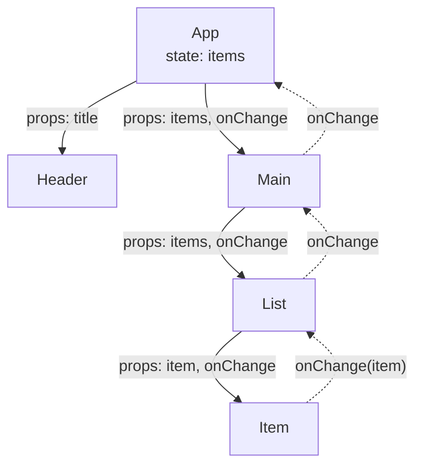

# 3.4 Komponenten, Props und State / React-Komponenten und "props", "children", "state"

## Components-Props

- Props sind die Eigenschaften, die an ein React-Element übergeben werden
- Props dürfen nicht verändert werden (immutable)
- Props sollten typisiert werden

# 3.4 Komponenten, Props und State / React-Komponenten und "props", "children", "state"

## Diagramm: Props nach unten, Callbacks nach oben




# 3.4 Komponenten, Props und State / React-Komponenten und "props", "children", "state"

## Typisierung von Props

- Die Typisierung von Props bietet folgende Vorteile:

1. Fehler werden zur Entwicklungszeit erkannt
2. Die Dokumentation wird verbessert
3. Die IDE kann die Entwickler unterstützen
4. Fehlererkennung beim Aufrufer
5. Fehlererkennung innerhalb der Komponente

# 3.4 Komponenten, Props und State / React-Komponenten und "props", "children", "state"

## Beispiel für typisierte Props

- Eine Komponente die eine Person anzeigt könnte folgendermaßen typisiert werden:

```typescript
interface PersonProps {
  name: string;
  age: number;
}
```
oder äquivalent

```typescript
type PersonProps = {
  name: string;
  age: number;
}
```

# 3.4 Komponenten, Props und State / React-Komponenten und "props", "children", "state"

## Beispiel für typisierte Props

- Die Komponente könnte dann folgendermaßen aussehen:

```typescript
function Person(props: PersonProps) {
  return (
    <div>
      <h1>{props.name}</h1>
      <p>{props.age}</p>
    </div>
  )
}
```

# 3.4 Komponenten, Props und State / React-Komponenten und "props", "children", "state"

## Beispiel für typisierte Props (Inline Typ-Definition)

- Die Props können auch direkt in der Funktionsdefinition typisiert werden:

```typescript
function Person(props: {
  name: string;
  age: number;
}) {
  return (
    <div>
      <h1>{props.name}</h1>
      <p>{props.age}</p>
    </div>
  )
}
```

# 3.4 Komponenten, Props und State / React-Komponenten und "props", "children", "state"

## Destructuring von Props

- In JavaScript können Variablen mittels Destructuring aus Objekten extrahiert werden

Beispiel:

```typescript
const person = {name: 'Max', age: 30};
const {name, age} = person;
console.log(name); // Max
console.log(age); // 30
```

Das erspart das Schreiben von `props.name` und `props.age`:

# 3.4 Komponenten, Props und State / React-Komponenten und "props", "children", "state"

## Destructuring von Props in React

```typescript
function Person(props: PersonProps) {
  const {name, age} = props;
  return (
    <div>
      <h1>{name}</h1>
      <p>{age}</p>
    </div>
  )
}
```

# 3.4 Komponenten, Props und State / React-Komponenten und "props", "children", "state"

## Destrukturierung von Props in React inline

```typescript
function Person({name, age}: PersonProps) {
  return (
    <div>
      <h1>{name}</h1>
      <p>{age}</p>
    </div>
  )
}
```

# 3.4 Komponenten, Props und State / React-Komponenten und "props", "children", "state"

## Destructuring und Typisierung inline

```typescript
function Person({name, age}: {name: string, age: number}) {
  return (
    <div>
      <h1>{name}</h1>
      <p>{age}</p>
    </div>
  )
}
```

# 3.4 Komponenten, Props und State / React-Komponenten und "props", "children", "state"

## Bool'sche Props

- Boolsche Props werden als optional typisiert, damit beim Aufruf der Komponente nicht immer ein Wert übergeben werden muss. Es wird also die bool'sche Prop auf `true` gesetzt, wenn sie übergeben wird. Ein setzen auf `false` ist nicht notwendig, es reicht, wenn die Prop nicht übergeben wird.

- Wenn der Wert der Props dynamisch ist, kann der Wert auch explizit auf `true` oder `false` gesetzt werden.


```typescript
interface PersonProps {
  name: string;
  age: number;
  student?: boolean;
}
```

Verwendung:

```typescript
export default function App() {
  return (
    <div>
      <Person name="Max" age={30} student />
    </div>
  )
}
```

# 3.4 Komponenten, Props und State / React-Komponenten und "props", "children", "state"

## Default Werte für Props (Destructuring)

- Default-Werte können direkt in der Destrukturierung definiert werden

```typescript
type PersonProps = {
  name: string;
  age: number;
}
function Person({name, age = 35 }: PersonProps) {
  return (
    <div>
      <h1>{name}</h1>
      <p>{age}</p>
    </div>
  )
}
```

# 3.4 Komponenten, Props und State / React-Komponenten und "props", "children", "state"

## Children-Props

Wenn man Komponenten ineinander verschachtelten möchte,
dann kann man dieses in der von HTML gewohnten Art und Weise tun:

```typescript
function Example() {
    return (
        <Wrapper>
          <Person name="Max" age={30}>
        </Wrapper>
    )
}
```

# 3.4 Komponenten, Props und State / React-Komponenten und "props", "children", "state"

## Children-Props

In der Wrapper-Komponente kann man dann die `children`-Props verwenden um die verschachtelten Komponenten anzuzeigen:


```typescript
function Wrapper({ children }: {children: React.ReactNode}) {
  return (
    <div>
        {children}
    </div>
  )
}
```

```children``` ist ein spezielles Attribut, welches alle verschachtelten Komponenten enthält. React stellt diesen Prop-Typ automatisch zur Verfügung.

# 3.4 Komponenten, Props und State / React-Komponenten und "props", "children", "state"

## Children-Props

Wenn children wie oben als required Feld definiert ist, dann muss es auch immer übergeben werden. Manchmal ist
es gewünscht, dass children optional sind. In diesem Fall kann man den Prop-Typ wie folgt mittels eines ? als optional definieren:

```typescript
function Wrapper({ children }: {children?: React.ReactNode}) {
  return (
    <div>
        {children}
    </div>
  )
}
```

# 3.4 Komponenten, Props und State / React-Komponenten und "props", "children", "state"

## Children-Props mit dem PropsWithChildren Type-Helper

Es gibt auch einen Type-Helper ```PropsWithChildren```, der die Typisierung von children-Props vereinfacht:

```typescript
import { PropsWithChildren } from "react";
export function Wrapper({ children, otherProp1, otherProps2 }
    : PropsWithChildren<{otherProp1: string, otherProp2?: number}>) {
  return (
    <div>
        {children}
    </div>
  )
}
```

# 3.4 Komponenten, Props und State / React-Komponenten und "props", "children", "state"

## Typisierung von Standard-HTML Attributen

Manchmal möchte man Standard-HTML Attribute des obersten HTML-Tags einer Komponente an diese übergeben. Dafür gibt es bei React die Typdefinitionen ```ComponentProps``` und ```ComponentPropsWithRef```-

Beispiel:

```typescript
import { ComponentProps } from "react";

// Typ-Vereinigungsmenge mittels & Operator
type MyDivProps = ComponentProps<"div"> & {
  myProp: string;
}

const MyDiv = ({ myProp, ...props }: MyDivProps) => {
  return <div {...props} />
}
```


