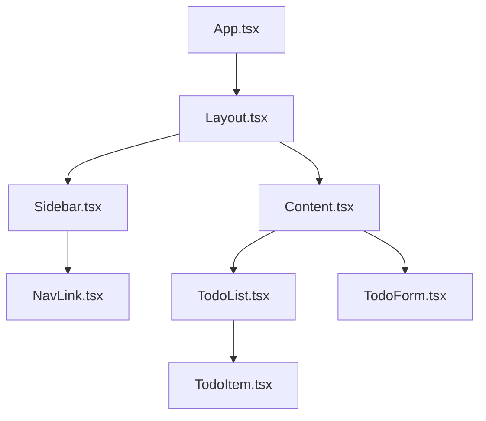

# 5.1 React-Komponenten im Detail / Projektstruktur: Aufteilen einer App in React-Komponenten

## React-Komponenten und Dateien

- In React wird eine App in Komponenten aufgeteilt.
- Komponenten können in verschiedenen Dateien definiert werden. Es können aber auch mehrere Komponenten in einer Datei definiert werden.

- Pro Datei kann es nur einen default-Export geben. (Wichtig, da manche Frameworks wie Router für Hauptseiten den Default-Exports verwenden)

- Komponenten können auch als lokale Funktion innerhalb einer anderen Komponente definiert werden. Davon ist jedoch ABZURATEN, da bei jedem Re-Rendering der Elternkomponente die lokale Funktion neu erstellt wird. Das kann zu unerwünschtem Verhalten führen und kostet auch Zeit.

# 5.1 React-Komponenten im Detail / Projektstruktur: Aufteilen einer App in React-Komponenten

## Diagramm: App in Komponenten und Dateien

