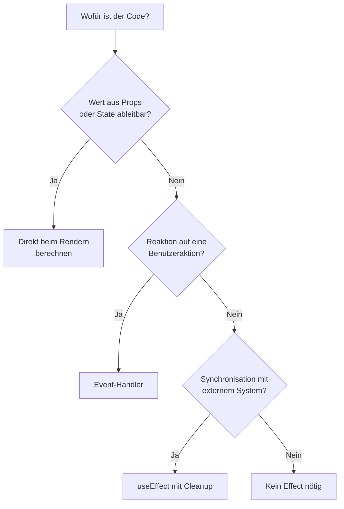

# 5.5 React-Komponenten im Detail / Wann useEffect() benötigt wird – und wann nicht

## You Might Not Need an Effect

- Ein Effect ist ein "Escape Hatch" für die Synchronisation mit Systemen außerhalb von React.
- Kein Effect nötig für:
    - Werte, die sich aus Props oder State berechnen lassen
    - Reaktionen auf Benutzeraktionen (Klick, Submit)
    - Zurücksetzen von State, wenn sich eine Prop ändert
- Unnötige Effects bedeuten zusätzliche Renderings, mehr Fehlerquellen und schwerer lesbaren Code.

# 5.5 React-Komponenten im Detail / Wann useEffect() benötigt wird – und wann nicht

## Diagramm: Brauche ich einen Effect?




# 5.5 React-Komponenten im Detail / Wann useEffect() benötigt wird – und wann nicht

## Abgeleitete Werte beim Rendern berechnen

```typescript
// Schlecht: redundanter State + Effect
const [fullName, setFullName] = useState('')
useEffect(() => {
    setFullName(firstName + ' ' + lastName)
}, [firstName, lastName])

// Gut: direkt beim Rendern berechnen
const fullName = firstName + ' ' + lastName
```

- Teure Berechnungen können mit useMemo gecacht werden (oder übernimmt der React Compiler, siehe 5.12).

# 5.5 React-Komponenten im Detail / Wann useEffect() benötigt wird – und wann nicht

## Events gehören in Event-Handler

```typescript
// Schlecht: Aktion über State und Effect ausgelöst
useEffect(() => {
    if (submitted) {
        postOrder(order)
    }
}, [submitted, order])

// Gut: Ursache direkt im Handler behandeln
function handleSubmit() {
    postOrder(order)
}
```

- Frage: Läuft der Code, weil die Komponente angezeigt wird (Effect) oder weil der Benutzer etwas getan hat (Handler)?

# 5.5 React-Komponenten im Detail / Wann useEffect() benötigt wird – und wann nicht

## State zurücksetzen mit key

- Soll eine Komponente bei neuer Identität komplett frisch starten, wird kein Effect gebraucht, sondern ein key.

```typescript
// Schlecht
useEffect(() => {
    setComment('')
}, [userId])

// Gut: neuer key = neue Komponenteninstanz mit leerem State
<Profile userId={userId} key={userId} />
```

# 5.5 React-Komponenten im Detail / Wann useEffect() benötigt wird – und wann nicht

## Wann useEffect wirklich nötig ist

- Synchronisation mit externen Systemen:
    - Subscriptions (WebSocket, Browser-Events wie resize)
    - Timer (setInterval)
    - Imperative DOM- oder Drittanbieter-APIs
- Immer mit Cleanup, damit der Effect sauber wieder abgebaut wird.

```typescript
useEffect(() => {
    const onResize = () => setWidth(window.innerWidth)
    window.addEventListener('resize', onResize)
    return () => window.removeEventListener('resize', onResize)
}, [])
```

- Daten laden: besser mit TanStack Query oder Router-Loadern (Kapitel 9 ff.).
