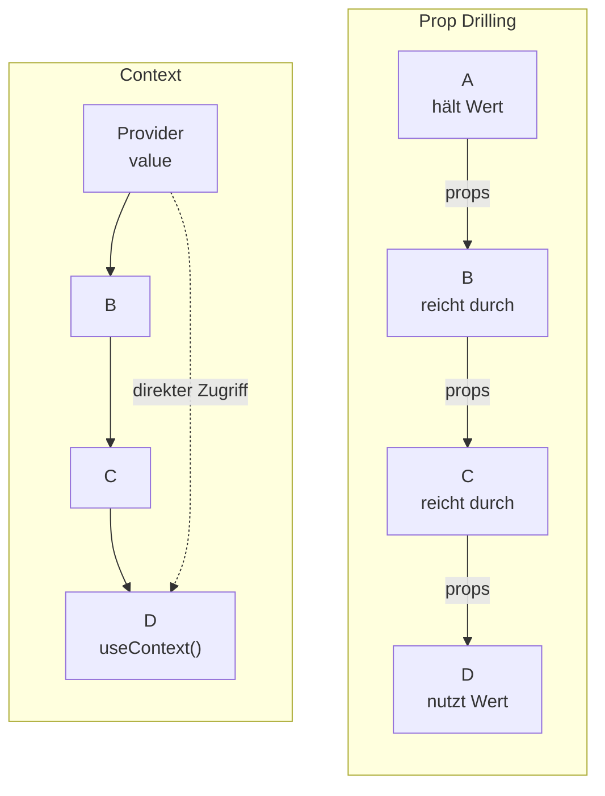

# 5.8 React-Komponenten im Detail / Verwendung der Context-API: useContext()

- useContext() ist ein Hook, der es ermöglicht, den Kontext einer Komponente zu verwenden und in der Hierarchie der Komponenten durchzureichen.

```typescript
import React from 'react'

const CounterContext = React.createContext(0)

export function CounterProvider({ children }) {
    const [count, setCount] = React.useState(0)
    return (
        <CounterContext.Provider value={{ count, setCount }}>
            {children}
        </CounterContext.Provider>
    )
}

export function Counter() {
    const { count, setCount } = React.useContext(CounterContext)
    return (
        <div>
            <button onClick={() => setCount(count + 1)}>Count : {count}</button>
        </div>
    )
}
```


# 5.8 React-Komponenten im Detail / Verwendung der Context-API: useContext()

## Diagramm: Prop Drilling vs. Context



