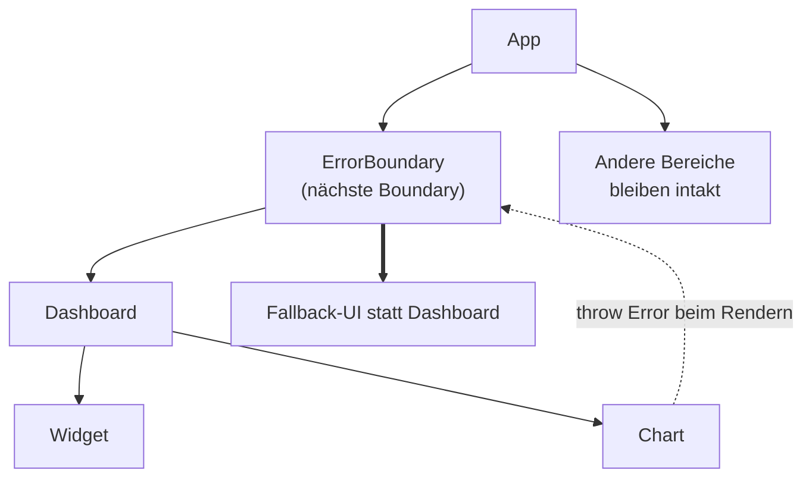

# 5.9 React-Komponenten im Detail / Error Boundaries

## Fehler beim Rendern abfangen

- Ein Fehler beim Rendern lässt ohne Gegenmaßnahme den gesamten Komponentenbaum verschwinden (weiße Seite).
- Eine Error Boundary fängt Fehler in ihren Kindern ab und zeigt stattdessen eine Fallback-UI.
- Abgefangen werden Fehler beim Rendern, in Lifecycle-Methoden und in Konstruktoren der Kind-Komponenten.
- Error Boundaries müssen (Stand React 19) weiterhin Klassenkomponenten sein (getDerivedStateFromError, componentDidCatch). Es gibt keinen Hook dafür.
- In der Praxis: Bibliothek react-error-boundary.

```bash
npm install react-error-boundary
```

# 5.9 React-Komponenten im Detail / Error Boundaries

## Diagramm: Fehler bubbelt zur Error Boundary




# 5.9 React-Komponenten im Detail / Error Boundaries

## react-error-boundary

```typescript
import { ErrorBoundary, type FallbackProps } from 'react-error-boundary';

function Fallback({ error, resetErrorBoundary }: FallbackProps) {
    return (
        <div role="alert">
            <p>Etwas ist schiefgelaufen: {error.message}</p>
            <button onClick={resetErrorBoundary}>Erneut versuchen</button>
        </div>
    )
}

export function App() {
    return (
        <ErrorBoundary
            FallbackComponent={Fallback}
            onError={(error) => console.error(error)}
            onReset={() => { /* State zurücksetzen */ }}
        >
            <Dashboard />
        </ErrorBoundary>
    )
}
```

# 5.9 React-Komponenten im Detail / Error Boundaries

## Was nicht abgefangen wird

- Fehler in Event-Handlern (try/catch verwenden)
- Asynchroner Code (setTimeout, Promises, fetch)
- Server-seitiges Rendern
- Fehler in der Error Boundary selbst

- Platzierung: eine Boundary um die App (letzte Rettung) und gezielt um unabhängige Bereiche, damit nur ein Teil ausfällt.
- Mit useErrorBoundary aus react-error-boundary lassen sich async-Fehler gezielt in die nächste Boundary werfen:

```typescript
const { showBoundary } = useErrorBoundary()
fetchData().catch(showBoundary)
```
