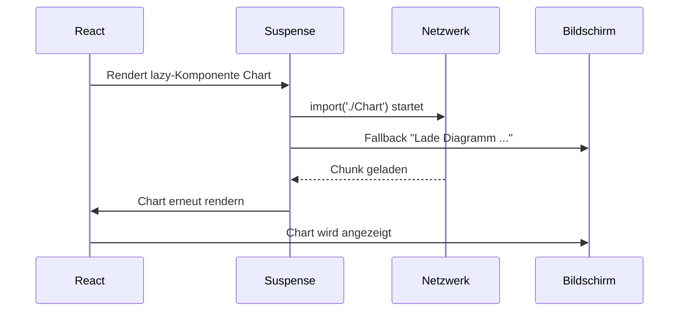

# 5.10 React-Komponenten im Detail / Lazy Loading und Suspense

## Code Splitting mit React.lazy

- Standardmäßig landet der gesamte Code in einem Bundle. Beim Code Splitting werden Teile erst bei Bedarf nachgeladen.
- React.lazy erwartet eine Funktion, die ein dynamisches import() liefert. Die Komponente muss per default exportiert werden.
- Vite erzeugt dafür automatisch einen eigenen Chunk.

```typescript
import { lazy } from 'react';

const Chart = lazy(() => import('./Chart'));
```

# 5.10 React-Komponenten im Detail / Lazy Loading und Suspense

## Suspense

- Suspense zeigt eine Fallback-UI, solange eine Kind-Komponente noch nicht bereit ist.

```typescript
import { lazy, Suspense } from 'react';

const Chart = lazy(() => import('./Chart'));

export function Report() {
    return (
        <Suspense fallback={<p>Lade Diagramm ...</p>}>
            <Chart />
        </Suspense>
    )
}
```

- Suspense wird auch von Datenbibliotheken (z. B. TanStack Query mit useSuspenseQuery) und von use() genutzt.

# 5.10 React-Komponenten im Detail / Lazy Loading und Suspense

## Diagramm: Lazy Loading mit Suspense




# 5.10 React-Komponenten im Detail / Lazy Loading und Suspense

## Lazy Loading pro Route und mit Error Boundary

- Sinnvolle Schnittstellen für Code Splitting: Routen und selten genutzte, schwere Komponenten (Editoren, Charts, Dialoge).
- Schlägt das Nachladen fehl (Netzwerk), wird ein Fehler geworfen. Deshalb Suspense mit Error Boundary kombinieren.

```typescript
<ErrorBoundary fallback={<p>Laden fehlgeschlagen</p>}>
    <Suspense fallback={<Spinner />}>
        <Routes>
            <Route path="/admin" element={<Admin />} />
        </Routes>
    </Suspense>
</ErrorBoundary>
```

- React Router 7 bietet zusätzlich eine eigene lazy-Option an Routen (Framework- und Data-Mode).
