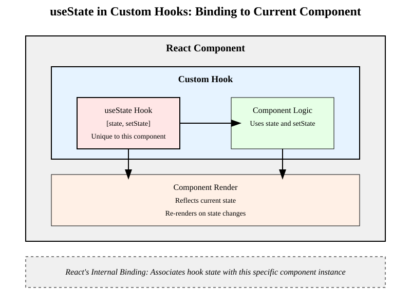

# 7.12 Hooks und moderne React Patterns / Erstellen und Verwenden von "Custom Hooks"

## Custom Hooks

- Custom Hooks sind Funktionen, die mit `use` beginnen und andere Hooks verwenden. 
- Die meisten Custom-Hooks verwenden intern State und sehr oft auch Effekte um die Logik zu kapseln und wiederzuverwenden.
- Wichtigste Erkenntnis: Custom Hooks sind eine Möglichkeit, Logik zu kapseln und wiederzuverwenden und Aufrufe von `useState` und `useEffect` binden sich an die aktuell durchlaufene Komponente. Nur deswegen funktioniert das Konzept von Custom Hooks.
- Libraries und Frameworks die auf React basieren verwenden Custom Hooks um Funktionalität bereitzustellen.
- Custom Hooks können in anderen Komponenten verwendet werden.
- Custom Hooks die Zustand verwenden (via useState oder useReducer) können in anderen Komponenten verwendet werden, um deren Zustand zu verwalten.
- Hooks binden sich immer an die Komponente, in der sie verwendet werden. Der Aufruf eines Customhooks ist gleichbedeutend mit dem Aufruf des Hooks in der Komponente, in der es definiert wurde. 
- Custom Hooks dürfen kein JSX zurückgeben, sonst wären sie Komponenten und keine Hooks.


# 7.12 Hooks und moderne React Patterns / Erstellen und Verwenden von "Custom Hooks"

## Custom Hooks und useState: Bindung an die Komponente



# 7.12 Hooks und moderne React Patterns / Erstellen und Verwenden von "Custom Hooks"

## Weiteres Beispiel für einen Custom Hook

- ForceUpdate/ForceRender ist in der Regel nicht notwendig, demonstriert jedoch, wie man einen Custom Hook für eine ForceRender-Funktion implementieren kann.

```typescript
function useForceRender() {
    const [ trigger, setTrigger ] = useState(false)
    return () => { setTrigger(!trigger) }
}
```

Verwendung wäre wie folgt:
```typescript
export function Refs() {
    const forceRenderFunc = useForceRender()
    function onClick(e: MouseEvent) {
        forceRenderFunc()
    }
    ...
}
```

# 7.12 Hooks und moderne React Patterns / Erstellen und Verwenden von "Custom Hooks"

## Custom Hooks

- Beispiel: Ein Custom Hook für die aktuelle Fenstergröße

```typescript
import { useEffect, useState } from 'react'

export function useWindowSize() {
    const [size, setSize] = useState({ width: window.innerWidth, height: window.innerHeight })

    useEffect(() => {
        const handleResize = () => {
            setSize({ width: window.innerWidth, height: window.innerHeight })
        }
        window.addEventListener('resize', handleResize)
        return () => {
            window.removeEventListener('resize', handleResize)
        }
    }, [])

    return size
}
```

# 7.12 Hooks und moderne React Patterns / Erstellen und Verwenden von "Custom Hooks"

## Der useWindowSize Custom Hook in der Verwendung

- Verwendung des Hooks liefert dann REAKTIV die Windowgröße (jedes mal wenn sich die Fenstergröße ändert)

```typescript
export function MyComponent() {
    const size = useWindowSize()
    return <div>Width={size.width}, Height={size.height}</div>
}
```

- Komponenten die diesen Hook verwenden, rendern sich also jedes
mal neu, wenn sich die Fenstergröße ändert und bekommen die
aktuelle Fenstergröße übergeben.

# 7.12 Hooks und moderne React Patterns / Erstellen und Verwenden von "Custom Hooks"

## Weitere typische Beispiel für Custom Hooks

- useCurrentUser()
- useLocalStorage()
- useFetch()
- useDebounce()
- useThrottle()
- useInterval()
- useWindowScrollPosition()
- useOrientation()
- useOnlineStatus()
- useGeolocation()
...

# 7.12 Hooks und moderne React Patterns / Erstellen und Verwenden von "Custom Hooks"

## Custom Hooks und Zustand

- Viele der Custom-Hooks sind nach dem gleichem Schema aufgebaut:
  - Zustand definieren
  - Effekt definieren
  - Effekt registrieren
  - Cleanup definieren
  - Cleanup registrieren

- Man kann also auch Custom-Hooks für eigene Modell-Klassen definieren, die dann in anderen Komponenten verwendet werden können.


