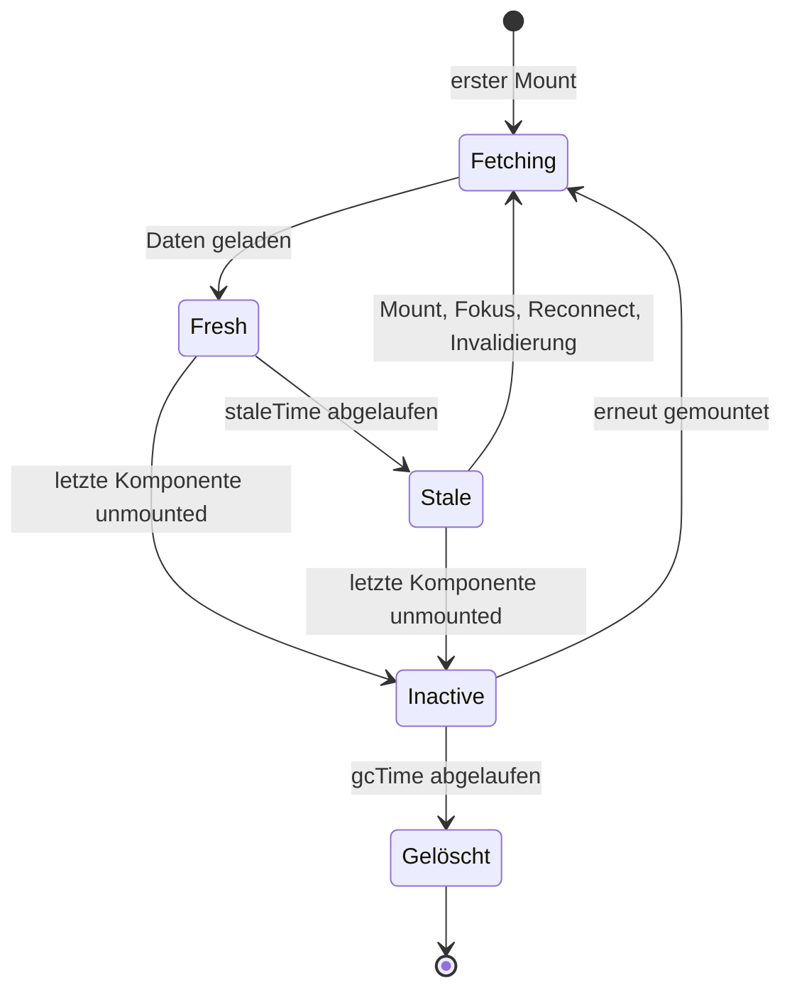

# 9.9 HTTP, APIs und Server State / TanStack Query: Server State, Caching und Synchronisation

## Was ist Server State?

- Server State sind Daten, die **auf dem Server liegen** und im Browser nur eine Kopie (Snapshot) sind.
- Eigenschaften:
  - gehört nicht der App, andere Nutzer können ihn jederzeit ändern
  - ist asynchron zu laden und kann veralten
  - wird von mehreren Komponenten gleichzeitig gebraucht
- Das ist etwas anderes als UI-State (offenes Menü, Formularinhalt, Tab-Auswahl).
- TanStack Query verwaltet diese Kopie: laden, cachen, de-duplizieren, aktualisieren, Fehler und Retries.
- Ersatz für das manuelle `useEffect` + `useState` + Loading/Error-Gerüst aus den vorherigen Folien.

# 9.9 HTTP, APIs und Server State / TanStack Query: Server State, Caching und Synchronisation

## Setup

```bash
npm install @tanstack/react-query
npm install -D @tanstack/react-query-devtools
```

```typescript
// main.tsx
import { StrictMode } from 'react'
import { createRoot } from 'react-dom/client'
import { QueryClient, QueryClientProvider } from '@tanstack/react-query'
import { ReactQueryDevtools } from '@tanstack/react-query-devtools'
import { App } from './App'

const queryClient = new QueryClient()

createRoot(document.getElementById('root')!).render(
    <StrictMode>
        <QueryClientProvider client={queryClient}>
            <App />
            <ReactQueryDevtools initialIsOpen={false} />
        </QueryClientProvider>
    </StrictMode>
)
```

- Der `QueryClient` wird einmal außerhalb der Komponenten erzeugt und hält den Cache.
- Die DevTools zeigen alle Queries, ihren Status und Cache-Inhalt (werden im Produktions-Build nicht mitgebündelt).

# 9.9 HTTP, APIs und Server State / TanStack Query: Server State, Caching und Synchronisation

## Caching: staleTime und gcTime

- Jede Query liegt im Cache unter ihrem `queryKey`.
- **`staleTime`**: wie lange Daten als frisch gelten (Standard: `0`, d. h. sofort stale). Frische Daten werden ohne Netzwerk aus dem Cache geliefert.
- **`gcTime`**: wie lange eine Query ohne aktive Nutzer (kein gemounteter Observer) im Cache bleibt, bevor sie entfernt wird (Standard: 5 Minuten).
- Stale-Daten werden sofort angezeigt und im Hintergrund neu geladen (stale-while-revalidate).
- Automatisches Refetching bei neuem Mount, Fensterfokus und Netzwerk-Reconnect.

```typescript
const queryClient = new QueryClient({
    defaultOptions: {
        queries: {
            staleTime: 60 * 1000,       // 1 Minute frisch
            gcTime: 10 * 60 * 1000,     // 10 Minuten im Cache halten
        },
    },
})
```


# 9.9 HTTP, APIs und Server State / TanStack Query: Server State, Caching und Synchronisation

## Diagramm: Lebenszyklus einer Query im Cache



