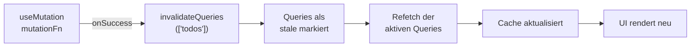

# 9.12 HTTP, APIs und Server State / Query Invalidation und Refetching

## Invalidation nach einer Mutation

- Nach einer Mutation ist der Cache veraltet: die Todo-Liste kennt das neue Todo noch nicht.
- `invalidateQueries` markiert passende Queries als stale und lädt aktive Queries sofort neu.

```typescript
import { useMutation, useQueryClient } from '@tanstack/react-query'

export function useCreateTodo() {
    const queryClient = useQueryClient()

    return useMutation({
        mutationFn: createTodo,
        onSuccess: () => queryClient.invalidateQueries({ queryKey: ['todos'] }),
    })
}
```

- Der Key ist ein **Präfix**: `['todos']` trifft auch `['todos', 5]` und `['todos', { completed: true }]`.
- Exakter Treffer mit `exact: true`.
- Gibt `onSuccess` das Promise zurück, bleibt `isPending` der Mutation bis zum Ende des Refetch aktiv.

# 9.12 HTTP, APIs und Server State / Query Invalidation und Refetching

## Diagramm: Mutation, Invalidierung und Refetch




# 9.12 HTTP, APIs und Server State / Query Invalidation und Refetching

## Automatisches und manuelles Refetching

- Standardmäßig lädt TanStack Query stale Daten neu bei: neuem Mount, Fensterfokus (`refetchOnWindowFocus`), Netzwerk-Reconnect (`refetchOnReconnect`).
- Polling über `refetchInterval` (in Millisekunden).
- Manuell über `refetch()` aus dem Query-Ergebnis.

```typescript
const { data, refetch, isFetching } = useQuery({
    queryKey: ['todos'],
    queryFn: fetchTodos,
    staleTime: 30_000,
    refetchOnWindowFocus: false,   // Standard: true
    refetchInterval: 10_000,       // alle 10 Sekunden neu laden
})

<button onClick={() => refetch()} disabled={isFetching}>
    Aktualisieren
</button>
```

- `refetchInterval` pausiert bei Standard im Hintergrund-Tab (`refetchIntervalInBackground: false`).
- Bei frischen Daten (`staleTime`) lösen Mount und Fokus keinen Request aus, `refetch()` dagegen immer.
