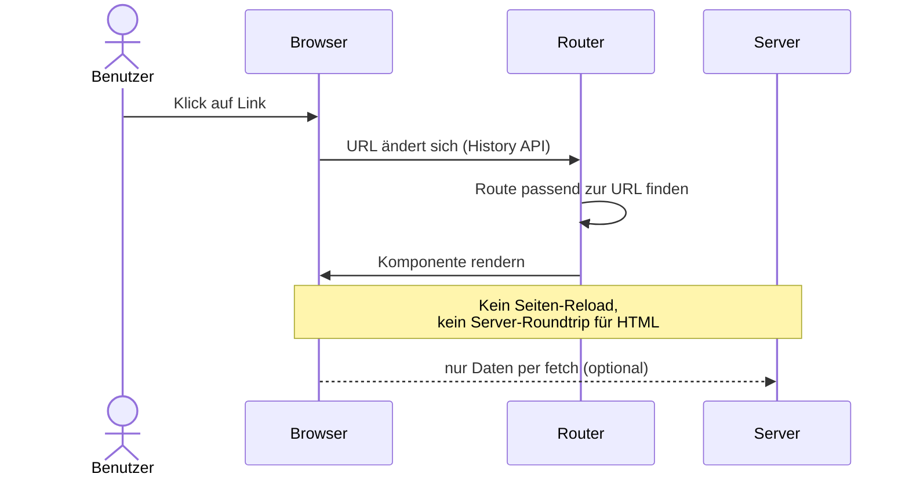

# 10.1 Routing mit React Router / Routing in "Single Page Application" (SPA)

## Routing Basics

- Routing ist zur Navigation in einer Webanwendung notwendig.
- In einer Single Page Application (SPA) wird die Seite nicht neu geladen, sondern nur der Inhalt ausgetauscht.
- Der Router ist dafür zuständig, die URL zu parsen und die entsprechende Komponente zu rendern.
- Der Router kann auch dazu verwendet werden, um die Navigation in der Webanwendung zu steuern.
- Der Standard-Router für React ist `react-router`.
- Dieser ist mittlerweile ein Teil von Remix.js.
- Außerdem bieten Router auch die Möglichkeit Daten zu laden, bevor die Komponente gerendert wird. (Sehr empfehlenswert).

# 10.1 Routing mit React Router / Routing in "Single Page Application" (SPA)

## Diagramm: Navigation in der SPA

# 10.1 Routing mit React Router / Routing in "Single Page Application" (SPA)

## Andere Router

- Next.js hat einen eigenen Router, der auf `react-router` basiert.
- Es gibt auch noch andere Router, wie z.B. `reach-router` oder `wouter`.
- Redux Toolkit bietet auch einen Router, der auf `react-router` basiert.
- Tanstack hat auch einen Router, der vollständig Typesafe ist.

# 10.1 Routing mit React Router / Routing in "Single Page Application" (SPA)

## Routing Paradigms

- Routing wird entweder im Code definiert oder über eine vorgegebene Struktur der Dateien definiert.
- Letzteres wird oft bei Next.js verwendet und nennt sich "Filesystem-based Routing".
- Remix.js und Tanstack verwenden auch primär Filesystem-based Routing.

