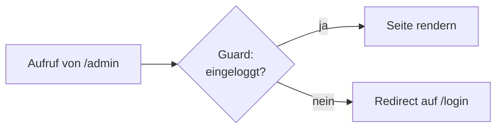

# 10.12 Routing mit React Router / Schutz von Routen mit "Guards"

## Redirects abhängig von Bedingungen

- Wenn bestimmte Bedingungen nicht erfüllt sind, wie zum Beispiel: Es existiert kein Benutzer, der eingeloggt ist, dann kann man mit einem Redirect auf eine andere Seite weiterleiten.

```typescript
// ProtectedRoute.js
import { useNavigate, useEffect } from 'react-router';
import { useAuth } from './AuthContext';

const ProtectedRoute = ({ children }) => {
  const { user } = useAuth();
  const navigate = useNavigate();

  useEffect(() => {
    if (!user) {
      navigate('/login', { replace: true });
    }
  }, [user, navigate]);

  // Wenn kein User vorhanden ist, returnen wir null
  // Die Weiterleitung erfolgt im useEffect
  if (!user) {
    return null;
  }

  return children;
};
```

- Achtung: Natürlich ist Client-seitige Authentifizierung nicht sicher. Hier geht es lediglich um die Darstellung und Benutzerführung.


# 10.12 Routing mit React Router / Schutz von Routen mit "Guards"

## Diagramm: Route Guard



