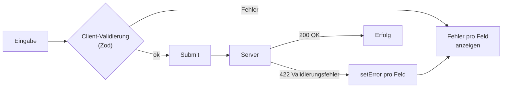

# 11.12 Formulare und Validierung / Serverseitige Validierungsfehler verarbeiten

## Warum Server-Validierung zusätzlich?

- Client-Validierung (Zod) verbessert die UX, ist aber **keine Sicherheit**: Der Server validiert immer erneut.
- Manche Regeln kennt nur der Server: "E-Mail bereits vergeben", abgelaufene Tokens, Geschäftsregeln.
- Der Server antwortet typischerweise mit **400/422** und einem Fehler-Objekt pro Feld.
- Ziel: diese Fehler im Formular an genau dem Feld anzeigen, wie einen Client-Fehler.

```json
{
    "message": "Validation failed",
    "errors": {
        "email": "Diese E-Mail ist bereits registriert",
        "password": "Passwort zu schwach"
    }
}
```


# 11.12 Formulare und Validierung / Serverseitige Validierungsfehler verarbeiten

## Diagramm: Validierungsfluss



# 11.12 Formulare und Validierung / Serverfehler mit setError auf Felder mappen

## setError und root-Fehler

- `setError('feldname', { type: 'server', message })` setzt einen Fehler wie ein Resolver.
- `setError('root.server', { ... })` ist für Fehler ohne Feldbezug (z. B. 500, Netzwerk).
- Die Fehler werden beim nächsten Submit automatisch zurückgesetzt.

```typescript
import { useForm } from 'react-hook-form'
import { zodResolver } from '@hookform/resolvers/zod'
import { z } from 'zod'

const schema = z.object({
    email: z.email('Ungültige E-Mail'),
    password: z.string().min(8, 'Mind. 8 Zeichen'),
})
type FormData = z.infer<typeof schema>

type ServerErrors = { errors?: Partial<Record<keyof FormData, string>> }

class ApiError extends Error {
    constructor(public status: number, public body: ServerErrors) { super('API error') }
}
```

# 11.12 Formulare und Validierung / Formular mit Mutation (TanStack Query)

## useMutation + setError

```typescript
import { useMutation } from '@tanstack/react-query'

async function register(data: FormData) {
    const res = await fetch('/api/register', {
        method: 'POST',
        headers: { 'Content-Type': 'application/json' },
        body: JSON.stringify(data),
    })
    if (!res.ok) throw new ApiError(res.status, await res.json())
    return res.json()
}

export function RegisterForm() {
    const { register: field, handleSubmit, setError,
        formState: { errors } } = useForm<FormData>({ resolver: zodResolver(schema) })

    const mutation = useMutation({
        mutationFn: register,
        onError: (err) => {
            if (err instanceof ApiError && err.status === 422) {
                for (const [name, message] of Object.entries(err.body.errors ?? {})) {
                    setError(name as keyof FormData, { type: 'server', message })
                }
            } else {
                setError('root.server', { message: 'Unerwarteter Fehler, bitte später erneut versuchen' })
            }
        },
    })
```

# 11.12 Formulare und Validierung / Formular mit Mutation (TanStack Query)

## JSX und Fehleranzeige

```typescript
    return (
        <form onSubmit={handleSubmit((data) => mutation.mutate(data))}>
            <input {...field('email')} placeholder="E-Mail" />
            {errors.email && <p role="alert">{errors.email.message}</p>}

            <input type="password" {...field('password')} placeholder="Passwort" />
            {errors.password && <p role="alert">{errors.password.message}</p>}

            {errors.root?.server && <p role="alert">{errors.root.server.message}</p>}

            <button type="submit" disabled={mutation.isPending}>Registrieren</button>
        </form>
    )
}
```

- `handleSubmit` führt zuerst die Zod-Validierung aus, `mutate` wird nur mit gültigen Daten aufgerufen.
- Mit `shouldFocus: true` als Option von `setError` springt der Fokus auf das fehlerhafte Feld.
