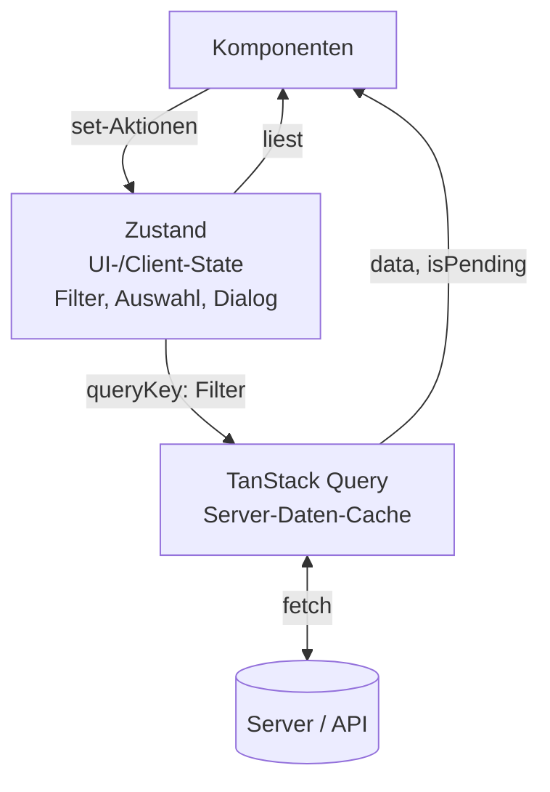

# 12.10 State Management mit Zustand / Zusammenspiel von Zustand und TanStack Query

## Aufgabenteilung

- **TanStack Query**: Daten vom Server (Listen, Details), Caching, Loading/Error, Refetching, Mutations.
- **Zustand**: Client-State, den der Server nicht kennt: Filter, ausgewählte Zeile, geöffneter Dialog, Sortierung, Theme.
- Der Client-State **parametrisiert** die Queries: Er landet im `queryKey`, TanStack Query lädt bei Änderung automatisch neu.

```typescript
import { create } from 'zustand'

type FilterStore = {
    search: string
    onlyOpen: boolean
    setSearch: (s: string) => void
    toggleOnlyOpen: () => void
}

export const useFilterStore = create<FilterStore>()((set) => ({
    search: '',
    onlyOpen: false,
    setSearch: (search) => set({ search }),
    toggleOnlyOpen: () => set((s) => ({ onlyOpen: !s.onlyOpen })),
}))
```

# 12.10 State Management mit Zustand / Zusammenspiel von Zustand und TanStack Query

## Diagramm: Wer besitzt welchen State?




# 12.10 State Management mit Zustand / Zusammenspiel von Zustand und TanStack Query

## Filter im Store steuert den queryKey

```typescript
import { useQuery } from '@tanstack/react-query'
import { useShallow } from 'zustand/react/shallow'

async function fetchTodos(filter: { search: string; onlyOpen: boolean }): Promise<Todo[]> {
    const params = new URLSearchParams({ q: filter.search, open: String(filter.onlyOpen) })
    const res = await fetch(`/api/todos?${params}`)
    if (!res.ok) throw new Error('Laden fehlgeschlagen')
    return res.json()
}

export function TodoList() {
    const filter = useFilterStore(useShallow((s) => ({ search: s.search, onlyOpen: s.onlyOpen })))

    const { data, isPending, error } = useQuery({
        queryKey: ['todos', filter],
        queryFn: () => fetchTodos(filter),
    })

    if (isPending) return <p>Lade ...</p>
    if (error) return <p role="alert">{error.message}</p>
    return <ul>{data.map((t) => <li key={t.id}>{t.text}</li>)}</ul>
}
```

- Jede Filter-Kombination hat ihren eigenen Cache-Eintrag, ein Zurückschalten ist sofort.

# 12.10 State Management mit Zustand / Zusammenspiel von Zustand und TanStack Query

## Anti-Patterns

- **Server-Daten in den Store kopieren** (`useEffect` + `setTodos(data)`): zwei Wahrheiten, Cache und Store laufen auseinander. `data` direkt aus `useQuery` verwenden.
- **Loading/Error-Flags im Store pflegen**, die TanStack Query bereits liefert.
- **Abgeleitete Server-Daten speichern**: berechnen oder per `select` in `useQuery` ableiten.
- **Auswahl als Objekt speichern**: besser nur die `selectedId` im Store halten und das Objekt aus dem Query-Cache lesen, sonst veraltet die Kopie.
- Faustregel: Gehört der Wert dem Server, bleibt er in TanStack Query. Gehört er dem Nutzer und der Oberfläche, kommt er in Zustand, `useState` oder die URL.
