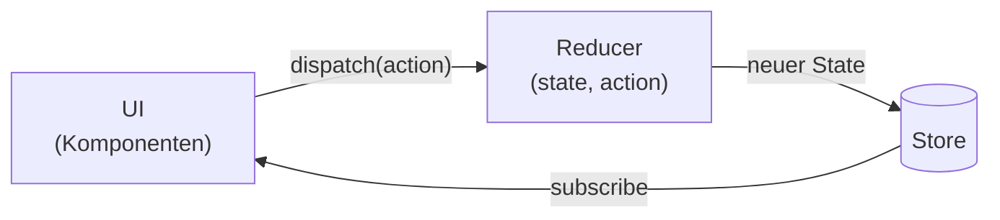

# 12.11 State Management mit Zustand / Den Redux-Datenfluss verstehen

## Wie funktionieren Reducer

- Ein Reducer ist eine Funktion, die den State einer Anwendung verwaltet. 
- Um den State zu verändern wird ein Action-Objekt benötigt. Der State wird insgesamt nicht verändert, sondern ein neuer State wird erzeugt.
- Achtung(!): JavaScript Objekte und Arrays sind Referenztypen. Das bedeutet, dass ein neuer State erzeugt werden muss, um den alten State nicht zu verändern.
- Die Standardwege ein Object zu kopieren sind `Object.assign()` oder der Spread-Operator `...`. Dabei wird aber nur eine flache Kopie erstellt. Für tiefe Kopien muss eine eigene Funktion geschrieben werden.
- Alternative Wege um tiefe Kopien zu erstellen sind `JSON.parse(JSON.stringify(obj))` oder die Bibliotheken `lodash` oder `immer`.

- Durch flache Kopien entsteht das alias-Problem. Das bedeutet, dass die Referenz auf das Objekt gleich bleibt, auch wenn die Eigenschaften des Objekts verändert werden. Das führt dazu, dass der State verändert wird, obwohl eine Kopie erstellt wurde. Das ist extrem schwierig zu debuggen.

# 12.11 State Management mit Zustand / Den Redux-Datenfluss verstehen

## Diagramm: Redux-Datenfluss

