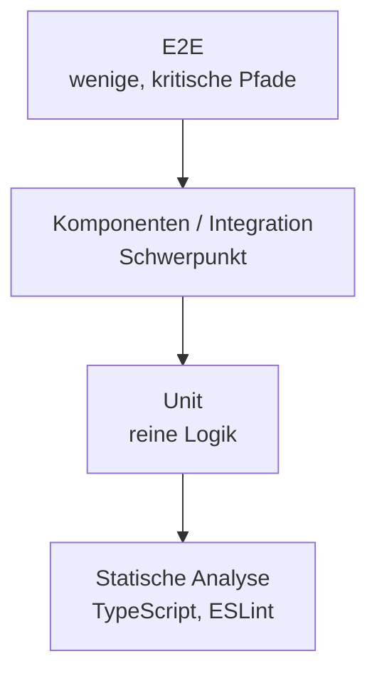

# 13.2 Testing / Teststrategie für moderne React-Anwendungen

## Testing Trophy statt Testpyramide

- Die klassische Testpyramide: viele Unit-Tests, wenige Integrationstests, noch weniger E2E-Tests.
- Die "Testing Trophy" (Kent C. Dodds) verschiebt den Schwerpunkt auf Integrationstests mit Komponenten.
- Statische Analyse (TypeScript, ESLint) bildet das Fundament und fängt Tippfehler und Typfehler ohne Testcode ab.
- Leitsatz: "The more your tests resemble the way your software is used, the more confidence they can give you."
- Je näher am Benutzer, desto höher das Vertrauen, aber auch desto langsamer und fragiler der Test.

# 13.2 Testing / Teststrategie für moderne React-Anwendungen

## Diagramm: Testing Trophy

# 13.2 Testing / Teststrategie: Was wird wie getestet?

| Ebene | Werkzeug | Testet |
|---|---|---|
| Statisch | TypeScript, ESLint | Typen, offensichtliche Fehler |
| Unit | Vitest | Reine Funktionen, Validierung, Utilities |
| Komponente / Integration | Vitest + RTL + MSW | Zusammenspiel von UI, Hooks, Stores, API |
| E2E | Playwright | Kritische Benutzerpfade im echten Browser |

- Unit-Tests: Logik ohne React (Formatierung, Zod-Schemas, Reducer, Berechnungen).
- Komponenten-Tests: Verhalten aus Sicht des Benutzers, Netzwerk wird mit MSW ersetzt.
- E2E-Tests: nur wenige, dafür für die wichtigsten Abläufe (Login, Checkout).

# 13.2 Testing / Teststrategie: Kosten und Nutzen

- Teste Verhalten, nicht Implementierung: Refactorings dürfen Tests nicht brechen.
- Teste, was für Benutzer und Geschäft wichtig ist, nicht jede Zeile (100 % Coverage ist kein Ziel).
- Mocke nur an den Systemgrenzen (Netzwerk, Uhrzeit, Zufall), nicht eigene Komponenten.
- Flaky Tests kosten Vertrauen: keine festen Wartezeiten, stattdessen auf Zustände warten.
- Fehler zuerst per Test reproduzieren, dann beheben (Regressionstest).
- Schnelle Tests laufen bei jedem Speichern (`vitest` Watch-Modus), langsame in der CI.
