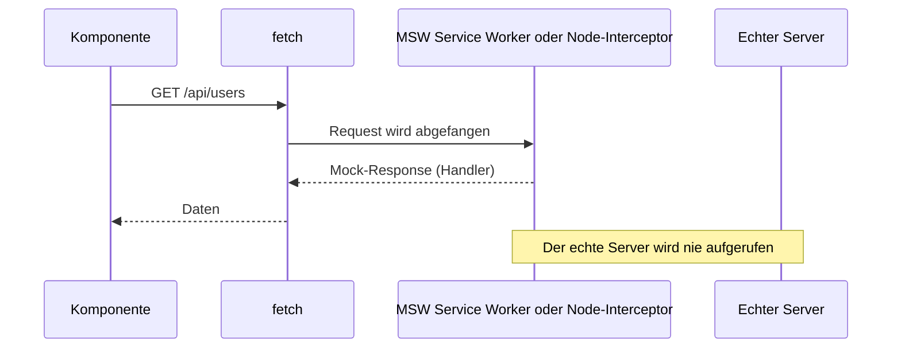

# 13.8 Testing / Mocking von APIs mit Mock Service Worker (MSW)

## Idee

- MSW fängt echte HTTP-Requests auf Netzwerkebene ab, `fetch` und Axios bleiben unverändert.
- Dieselben Handler können in Tests, Storybook und im Browser (Entwicklung) verwendet werden.
- Installation: `npm install -D msw` (Version 2, Handler mit `http` und `HttpResponse`).

```typescript
// src/mocks/handlers.ts
import { http, HttpResponse } from 'msw'

export const handlers = [
  http.get('/api/users/:id', ({ params }) =>
    HttpResponse.json({ id: params.id, name: 'Anna' })
  ),
  http.post('/api/login', async ({ request }) => {
    const body = await request.json()
    return HttpResponse.json({ token: 'abc', user: body })
  }),
]
```


# 13.8 Testing / Mocking von APIs mit Mock Service Worker (MSW)

## Diagramm: MSW fängt Requests ab



# 13.8 Testing / MSW im Vitest-Setup

- Ein Server für alle Tests in der Setup-Datei, Handler werden nach jedem Test zurückgesetzt.
- `onUnhandledRequest: 'error'` lässt Tests scheitern, wenn ein Request nicht gemockt ist.

```typescript
// src/mocks/server.ts
import { setupServer } from 'msw/node'
import { handlers } from './handlers'

export const server = setupServer(...handlers)
```

```typescript
// src/testsetup.ts
import '@testing-library/jest-dom/vitest'
import { server } from './mocks/server'

beforeAll(() => server.listen({ onUnhandledRequest: 'error' }))
afterEach(() => server.resetHandlers())
afterAll(() => server.close())
```

# 13.8 Testing / Handler pro Test überschreiben

- Mit `server.use()` ersetzt man einen Handler nur für den aktuellen Test, z.B. für Fehlerfälle.

```typescript
import { http, HttpResponse } from 'msw'
import { server } from '../mocks/server'

test('shows error message on server error', async () => {
  server.use(
    http.get('/api/users/:id', () =>
      HttpResponse.json({ message: 'boom' }, { status: 500 })
    )
  )

  render(<UserProfile userId="1" />, { wrapper: createWrapper() })

  expect(await screen.findByRole('alert')).toHaveTextContent(/fehler/i)
})
```

# 13.8 Testing / MSW mit TanStack Query

- Pro Test einen neuen `QueryClient`, sonst teilen sich Tests den Cache.
- `retry: false`, sonst wiederholt Query bei Fehlern mehrfach und der Test läuft in ein Timeout.

```typescript
import { QueryClient, QueryClientProvider } from '@tanstack/react-query'
import type { ReactNode } from 'react'

export function createWrapper() {
  const queryClient = new QueryClient({
    defaultOptions: { queries: { retry: false } },
  })
  return ({ children }: { children: ReactNode }) => (
    <QueryClientProvider client={queryClient}>{children}</QueryClientProvider>
  )
}

test('renders user name', async () => {
  render(<UserProfile userId="1" />, { wrapper: createWrapper() })
  expect(await screen.findByText('Anna')).toBeInTheDocument()
})
```
