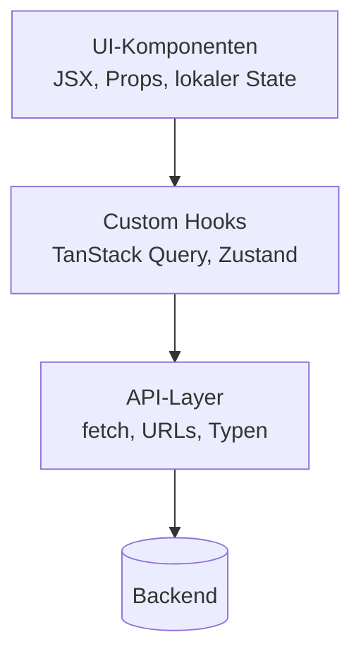

# 15.2 Best Practices und Architektur / Trennung von UI, Business Logic und API-Zugriffen

## Drei Schichten mit klaren Aufgaben

- UI-Komponenten: rendern JSX, kennen Props und lokalen UI-State, nichts über URLs oder `fetch`.
- Hooks: Anwendungslogik, Zugriff auf TanStack Query (Kapitel 9) und Zustand (Kapitel 12); liefern fertige Daten und Aktionen.
- API-Layer: reine Funktionen mit `fetch`, URLs, Fehlerbehandlung der HTTP-Ebene und Typen; kein React.
- Jede Schicht kennt nur die darunterliegende: UI → Hook → API.
- Vorteile: austauschbare Backends, einfache Tests (API mit MSW, Hooks und UI getrennt, Kapitel 13).

# 15.2 Best Practices und Architektur / Trennung von UI, Business Logic und API-Zugriffen

## Diagramm: Drei Schichten




# 15.2 Best Practices und Architektur / Schicht 1: API-Layer

```typescript
// features/todos/api/todos-api.ts
export type Todo = { id: number; title: string; done: boolean }

export async function fetchTodos(): Promise<Todo[]> {
    const response = await fetch('/api/todos')
    if (!response.ok) {
        throw new Error(`Todos laden fehlgeschlagen: ${response.status}`)
    }
    return response.json()
}

export async function createTodo(title: string): Promise<Todo> {
    const response = await fetch('/api/todos', {
        method: 'POST',
        headers: { 'Content-Type': 'application/json' },
        body: JSON.stringify({ title }),
    })
    if (!response.ok) throw new Error('Todo anlegen fehlgeschlagen')
    return response.json()
}
```

# 15.2 Best Practices und Architektur / Schicht 2 und 3: Hook und UI

```typescript
// features/todos/hooks/useTodos.ts
export function useTodos() {
    const queryClient = useQueryClient()
    const query = useQuery({ queryKey: ['todos'], queryFn: fetchTodos })
    const add = useMutation({
        mutationFn: createTodo,
        onSuccess: () => queryClient.invalidateQueries({ queryKey: ['todos'] }),
    })
    return { todos: query.data ?? [], isLoading: query.isPending, error: query.error, add: add.mutate }
}
```

```typescript
// features/todos/components/TodoList.tsx
export function TodoList() {
    const { todos, isLoading, error } = useTodos()
    if (isLoading) return <p>Lade ...</p>
    if (error) return <p role="alert">{error.message}</p>
    return <ul>{todos.map(t => <li key={t.id}>{t.title}</li>)}</ul>
}
```
