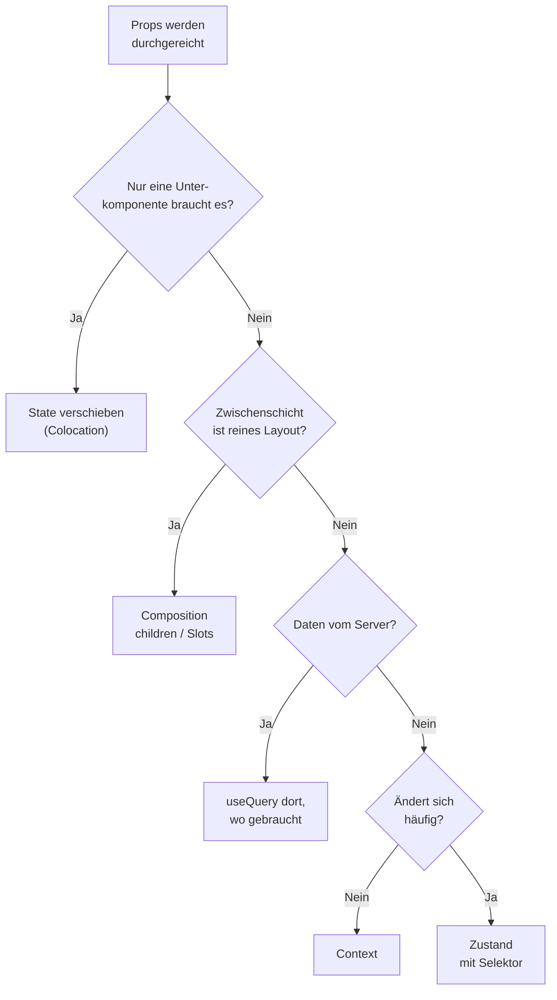

# 15.5 Best Practices und Architektur / Vermeidung von Prop Drilling

## Das Problem

- Prop Drilling: Props werden durch mehrere Zwischenkomponenten gereicht, die sie selbst gar nicht nutzen.
- Folge: Zwischenkomponenten sind an fremde Daten gekoppelt, Änderungen ziehen sich durch viele Dateien.
- Ein bis zwei Ebenen Props durchreichen ist normal und kein Problem; erst bei längeren Ketten handeln.
- Reihenfolge der Mittel: erst Struktur ändern, dann Context oder Store.

# 15.5 Best Practices und Architektur / Mittel gegen Prop Drilling

- Colocation: State dorthin verschieben, wo er verwendet wird (nicht in die App-Wurzel heben).
- Composition: Fertige Elemente als `children` oder benannte Slot-Props übergeben.
- Context (Kapitel 5 und 7): Werte, die sich selten ändern und im ganzen Teilbaum gebraucht werden (Theme, aktueller Benutzer).
- Zustand (Kapitel 12): Globaler Client State mit gezielter Selektion einzelner Werte.
- TanStack Query: Dieselbe Query darf in mehreren Komponenten stehen und wird gecacht; Daten müssen nicht heruntergereicht werden.

```typescript
// Composition: Layout kennt die Daten nicht
<Page sidebar={<UserMenu user={user} />}>
    <TodoList />
</Page>
```

# 15.5 Best Practices und Architektur / Wann welches Mittel?

| Situation | Mittel |
|---|---|
| Nur eine Unterkomponente braucht den State | State dorthin verschieben |
| Zwischenschicht ist reines Layout | Composition mit `children` / Slots |
| Seltene Änderungen, vieler Konsumenten (Theme) | Context |
| Häufig wechselnder globaler Zustand (Warenkorb) | Zustand mit Selektor |
| Daten vom Server | `useQuery` in der Komponente, die sie braucht |

- Context löst bei jeder Wertänderung Re-Renders aller Konsumenten aus; für schnell wechselnde Werte ist ein Store besser.


# 15.5 Best Practices und Architektur / Wann welches Mittel?

## Diagramm: Entscheidungsfluss gegen Prop Drilling



