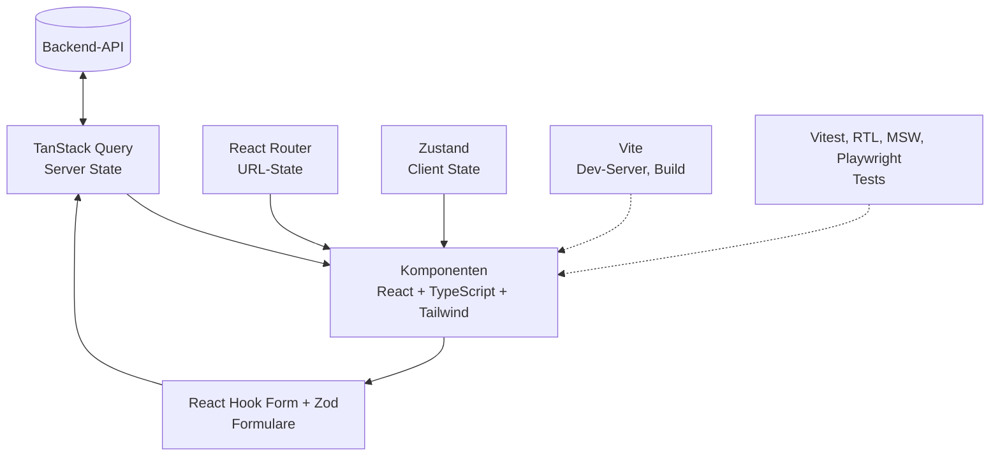

# 16.1 Seminar-Stack im Überblick / Der Seminar-Stack

## Bausteine und Aufgaben

| Baustein | Aufgabe | Kapitel |
|---|---|---|
| React + Vite | Komponentenmodell, Dev-Server, Build | 2, 3, 5 |
| TypeScript | Statische Typen für Props, State, API-Daten | 6 |
| Tailwind CSS | Styling mit Utility-Klassen | 4 |
| Hooks | State, Effects, eigene Logik-Bausteine | 7 |
| useHooks | Fertige Hooks für Alltagsaufgaben | 8 |
| TanStack Query | Server State: Laden, Cachen, Mutieren | 9 |
| React Router | Routing, URL-State, Lazy Loading | 10 |
| React Hook Form + Zod | Formulare und Validierung | 11 |
| Zustand | Globaler Client State | 12 |
| Vitest, RTL, MSW, Playwright | Unit-, Komponenten-, E2E-Tests | 13 |
| Build und Deploy | Produktionsbuild, Hosting | 14 |

# 16.1 Seminar-Stack im Überblick / Der Seminar-Stack

## Diagramm: Zusammenspiel der Bausteine




# 16.1 Seminar-Stack im Überblick / Zusammenspiel

## Aufbaureihenfolge im Seminar

```bash
React + TypeScript + Vite
  -> Tailwind CSS
  -> React Router
  -> Zustand
  -> TanStack Query
  -> React Hook Form + Zod
  -> useHooks
  -> Vitest + React Testing Library
  -> Playwright
```

## Datenfluss zur Laufzeit

```bash
Backend-API <-> API-Layer (fetch, Zod) <-> TanStack Query (Server State)
                                                |
URL (Router) ---> Hooks ---> Komponenten (Tailwind) <--- Zustand (Client State)
                                                |
                                 Formulare: React Hook Form + Zod
```

- Jeder Baustein löst genau ein Problem; Architektur siehe Kapitel 15.
