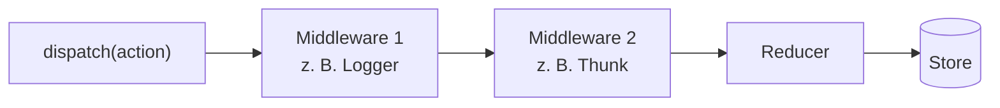

# 17.11 Legacy- und Überblicksthemen / Hinzufügen von Redux "Middleware"

- Anstelle von Middleware kann und sollte man die extraReducers-Funktion von Redux Toolkit verwenden.
- Mit den extraReducers können zusätzliche Reducer-Funktionen hinzugefügt werden und die Kommunikation mit anderen Stores oder anderen reaktiven Komponenten koordiniert werden.

# 17.11 Legacy- und Überblicksthemen / Hinzufügen von Redux "Middleware"

## Diagramm: Middleware-Kette

