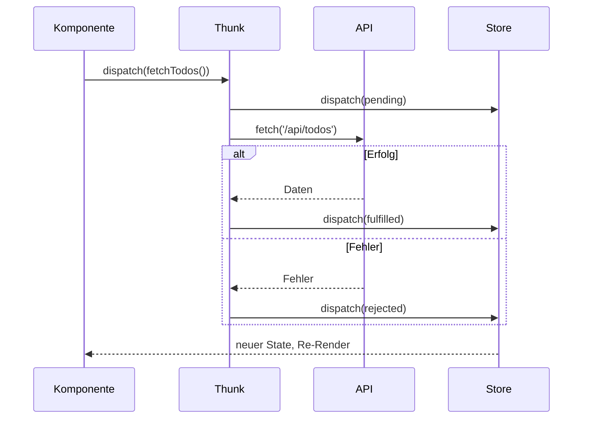

# 17.12 Legacy- und Überblicksthemen / Ausführen von Asynchronem Code

- mittels  createAsyncThunk  können asynchrone Funktionen erstellt werden.
- Außerdem können die Funktionen  dispatch  und  getState  verwendet werden.

# 17.12 Legacy- und Überblicksthemen / Ausführen von Asynchronem Code

## Diagramm: Thunk mit API-Aufruf

