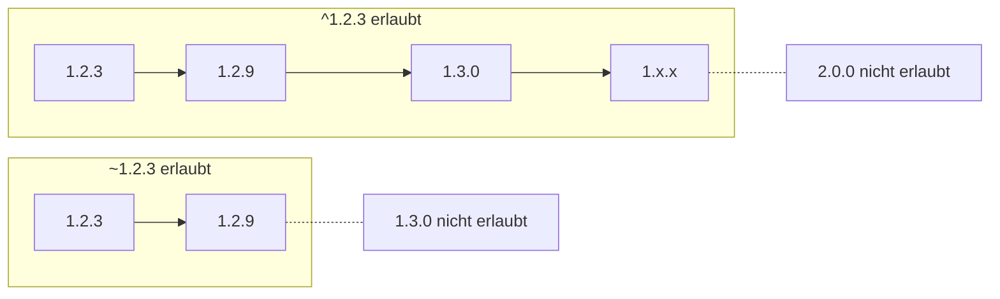

# 22.9 SemVer und npm (Zusatzthema) / Versions-Ranges: Caret (^)

## Das Caret-Symbol ^

- `^` ist der **Standard**, den npm beim Installieren einer Dependency in die `package.json` schreibt.
- `^` erlaubt alle Updates, die laut SemVer garantiert abwärtskompatibel sein sollten - also MINOR- und PATCH-Updates, aber kein MAJOR-Update.

```
^1.2.3  bedeutet erlaubt: >=1.2.3 <2.0.0
^0.2.3  bedeutet erlaubt: >=0.2.3 <0.3.0   (Sonderfall bei 0.y.z, siehe unten)
^0.0.3  bedeutet erlaubt: nur genau 0.0.3
```

- Bei `0.y.z`-Versionen ist npm vorsichtiger: Solange die erste von links gesehen "nicht-null" Ziffer gleich bleibt, gilt das Update als erlaubt. Das spiegelt wider, dass `0.x`-Pakete laut SemVer noch keine stabile API garantieren.

# 22.9 SemVer und npm (Zusatzthema) / Versions-Ranges: Tilde (~) und Exakt

## Weitere gängige Ranges

```
~1.2.3   bedeutet erlaubt: >=1.2.3 <1.3.0   (nur PATCH-Updates)
1.2.3    bedeutet erlaubt: exakt diese Version, keine Updates
```

- `~` wird verwendet, wenn man nur Bugfixes automatisch erhalten möchte, aber keine neuen Funktionen.
- Eine exakte Version (ohne `^` oder `~`) "pinnt" die Abhängigkeit vollständig - nützlich, wenn man jede Änderung explizit selbst steuern möchte.


# 22.9 SemVer und npm (Zusatzthema) / Versions-Ranges: Caret (^)

## Diagramm: Welche Versionen passen?


